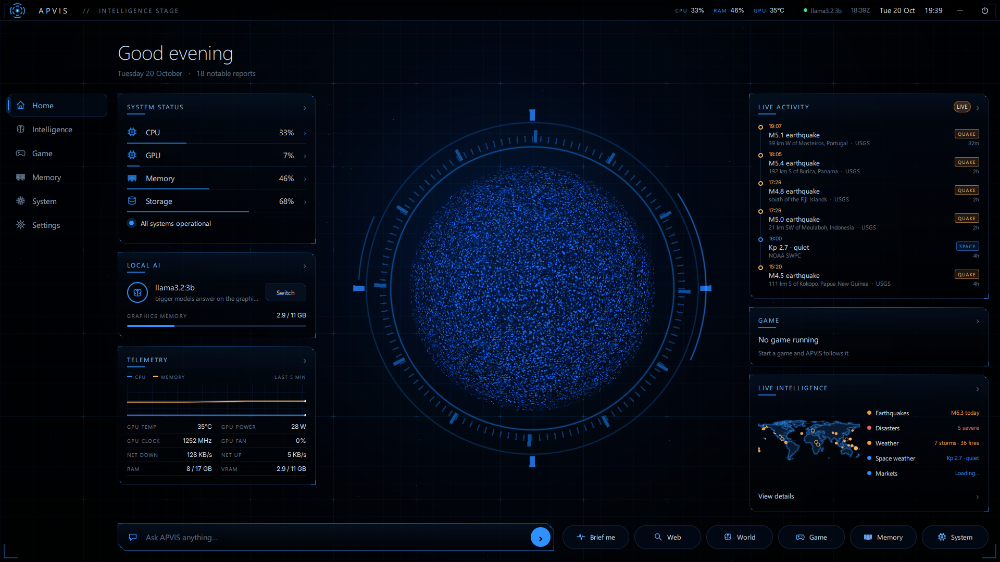
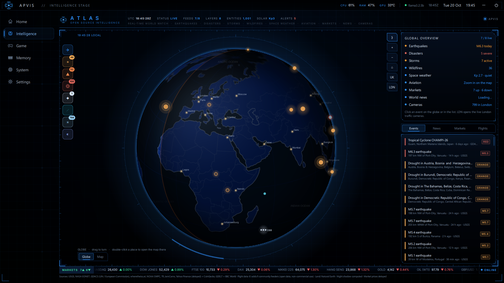

# APVIS for Windows

APVIS as a Windows app: a full-screen intelligence dashboard on its own monitor (your second screen when it's
connected, otherwise the main one), in APVIS 7's blue "Neural Fabric" look. It follows the world through open data,
answers with local AI on your graphics card, and follows the game you're playing.

It is the Windows companion to [APVIS OS](https://github.com/LUCKY-LKY3/APVIS-OS) (the Debian-based OS that runs
on the OptiPlex). The APVIS code in `app/` is copied from there with `scripts/sync-from-apvis-os.sh`; the Windows
layout switches on by itself when it runs on Windows.

## What's in it

- **Home**: the JARVIS particle core (all blue, drawn on the graphics card, at your monitor's refresh rate) in its
  HUD ring; System status (CPU, GPU, memory, storage), Local AI, and Telemetry (CPU and memory graph, GPU
  temperature, power, clock, fan, network, RAM, graphics memory) on the left; a Live Activity timeline of real
  reports, the Game card and a world summary on the right; the Ask bar and quick actions (Brief me, Web, World,
  Game, Memory, System) along the bottom.
- **Intelligence**: the world globe, also at your monitor's refresh rate, with earthquakes (USGS), natural events
  (NASA EONET), disasters (GDACS), space weather (NOAA), the ISS, about 3,000 satellites (CelesTrak orbits, positions
  computed on this PC; click one for its details and orbit), London traffic cameras, markets and news (BBC World,
  Tech, Science), plus flights when you zoom in.
- **Ask**: local AI through [Ollama for Windows](https://ollama.com/download). Bigger models (e.g. `qwen3.5:9b`)
  answer on the graphics card; quick questions use a small one. Web search when it isn't sure, news catch-up,
  conversation memory.
- **Game mode**: spots the game you are playing (Steam, Epic, Riot, GOG, Ubisoft, EA, Xbox libraries, or any
  full-screen game), times sessions and playtime, and shows live CPU, GPU, temperature, graphics memory, power and
  clock from your NVIDIA card. While a game runs, APVIS clears its models off the graphics card, answers in light
  mode on the CPU, and slows its animations, so the game gets the GPU.

Things that only exist on APVIS OS (power, Wi-Fi, remote access, the Apps Store, the login screen, signed
updates, the terminal) are not part of the Windows app.

## Install

1. Install [Ollama](https://ollama.com/download) and pull models, e.g. `ollama pull qwen3.5:9b` and
   `ollama pull llama3.2:3b`.
2. Build the package (needs a Python 3.12 folder with PySide6 and psutil):
   `powershell -ExecutionPolicy Bypass -File scripts\build-package.ps1 -Python <that folder>`
3. Install it from `dist\APVIS`:
   `powershell -ExecutionPolicy Bypass -File dist\APVIS\Install-APVIS.ps1 [-StartWithWindows]`
4. Start **APVIS** from the Start menu. The — button minimises it; the power button or **Alt+F4** closes it.

Options: set `APVIS_SCREEN=1` (or 2, …) to choose the monitor, `APVIS_WINDOWED=1` for a normal window.
Your APVIS data lives in `%LOCALAPPDATA%\APVIS` (memory vault, settings, satellite cache, a log in `apvis.log`).

## Layout

| Path | What |
|---|---|
| `APVIS.pyw` | the launcher |
| `app/` | APVIS (Python package `apvis_os`, QML, art, map data) copied from APVIS OS |
| `scripts/` | sync from APVIS OS, build the package, install / uninstall |
| `docs/` | screenshots |
