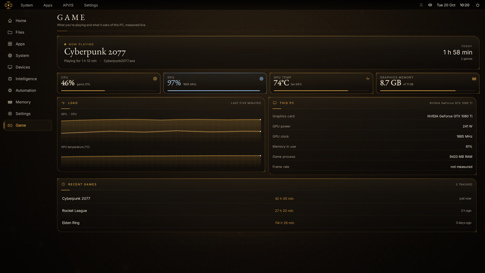

# APVIS for Windows

APVIS Home as a Windows app: full screen on its own monitor (your second screen when it's connected, otherwise the
main one), with the same lacquer-and-gold look, the APVIS core, and Ask with local AI. On a gaming PC it also
follows the game you're playing and shows its live stats (game mode).

It is the Windows companion to [APVIS OS](https://github.com/LUCKY-LKY3/APVIS-OS) (the Debian-based OS that runs
on the OptiPlex). The APVIS code in `app/` is copied from there with `scripts/sync-from-apvis-os.sh`.

## What works on Windows

- Home, the core and the whole look; System, Memory, Atlas, Settings.
- **Ask** with local AI through [Ollama for Windows](https://ollama.com/download) (it uses your graphics card),
  web search when it isn't sure, news catch-up, conversation memory, pictures.
- **Game mode**: spots the game you are playing (Steam, Epic, Riot, GOG, Ubisoft, EA, Xbox libraries, or any full-screen game), times your sessions and playtime, and shows live CPU, GPU, temperature, graphics memory, power and clock from your NVIDIA card. Frame rate shows only if PresentMon is installed.

Things that only exist on APVIS OS (power, Wi-Fi, remote access, the Apps Store's installs, the login screen,
signed updates) are not part of the Windows app.

## Install

1. Install [Ollama](https://ollama.com/download) and pull a model, e.g. `ollama pull llama3.2:3b`.
2. Build the package (needs a Python 3.12 folder with PySide6 and psutil):
   `powershell -ExecutionPolicy Bypass -File scripts\build-package.ps1 -Python <that folder>`
3. Install it from `dist\APVIS`:
   `powershell -ExecutionPolicy Bypass -File dist\APVIS\Install-APVIS.ps1 [-StartWithWindows]`
4. Start **APVIS** from the Start menu. **Alt+F4** closes it.

Options: set `APVIS_SCREEN=1` (or 2, …) to choose the monitor, `APVIS_WINDOWED=1` for a normal window.
Your APVIS data lives in `%LOCALAPPDATA%\APVIS` (memory vault, settings, a log in `apvis.log`).

## Layout

| Path | What |
|---|---|
| `APVIS.pyw` | the launcher |
| `app/` | APVIS Home (Python package `apvis_os`, QML, art, map data) copied from APVIS OS |
| `scripts/` | sync from APVIS OS, build the package, install / uninstall |
